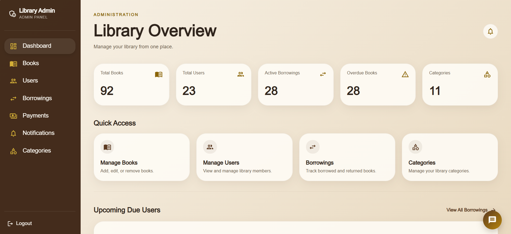
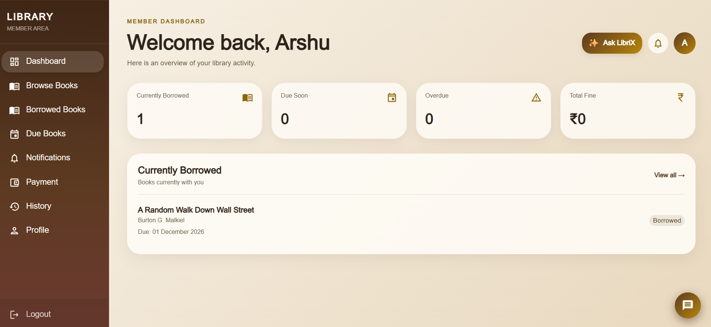
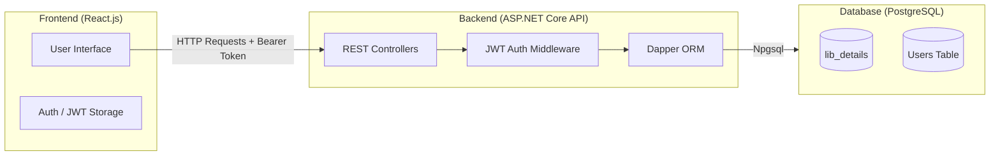
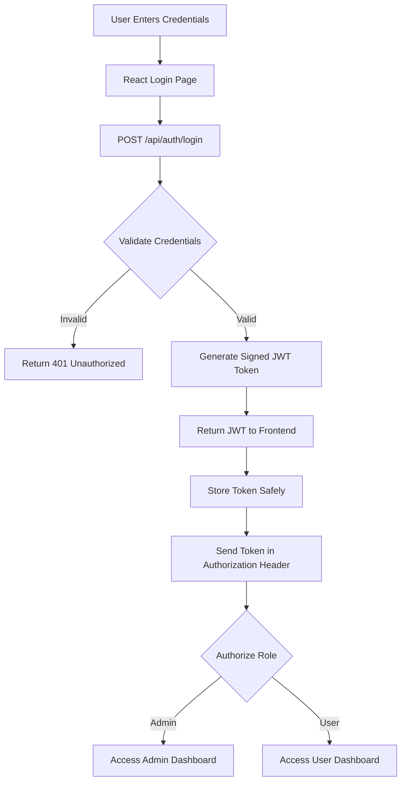

# 📚 Library Management System

<p align="center">
  
</p>

A full-stack Library Management System built using **React.js**, **ASP.NET Core Web API (.NET 10)**, **PostgreSQL**, and **JWT Authentication**. The application provides a centralized platform for managing library books, handling user authentication, and controlling access based on user roles.

The system supports two user roles:
- **Admin**: Manage books (CRUD), monitor total registered users, and access administrative tools.
- **User**: Browse active library books and access authorized member features.

---

## 📑 Table of Contents
- [Project Overview](#-project-overview)
- [Screenshots](#-screenshots)
- [Key Features](#-key-features)
- [Technology Stack](#️-technology-stack)
- [System Architecture](#-system-architecture)
- [Authentication and Authorization](#-authentication-and-authorization)
- [Database Design](#-database-design)
- [Project Structure](#-project-structure)
- [Installation and Setup](#️-installation-and-setup)
- [API Documentation](#-api-documentation)
- [Security Considerations](#-security-considerations)
- [Future Enhancements](#-future-enhancements)
- [Contributing](#-contributing)
- [Author](#-author)
- [License](#-license)

---

## 🚀 Project Overview

The Library Management System is designed to simplify and streamline library operations through a modern, responsive web application following a decoupled client-server architecture:

- **Frontend**: React.js provides an interactive and responsive user interface.
- **Backend**: ASP.NET Core Web API handles business logic, security, and CRUD endpoints.
- **Database**: PostgreSQL stores library records, user accounts, and credentials.
- **Authentication**: JWT (JSON Web Token) secures API communication and maintains stateless user sessions.
- **Data Access**: Dapper ORM executes fast, lightweight, and parameterized SQL queries.

---

## 📸 Screenshots

| 🏠 Home Page | 🔐 Login Page |
| :---: | :---: |
|  |  |

| 🛠️ Admin Dashboard | 📖 User Dashboard |
| :---: | :---: |
|  |  |

---

## ✨ Key Features

### 1. User Authentication & Authorization
- Secure user authentication using JWT.
- User registration and login flows.
- Bearer token-based protection for API endpoints.
- Role-Based Access Control (RBAC) separating **Admin** and **User** permissions.

### 2. Admin Dashboard
- Dedicated Admin management interface.
- View and manage complete library catalog.
- Add new books with author and ISBN details.
- Update existing book records.
- Soft-delete books from the active catalog.
- Monitor total count of registered users.

### 3. User Dashboard
- Dedicated User member interface.
- Search and browse available active books.
- Access library catalog according to user permissions.

### 4. Book Management (CRUD)
- **Create**: Add new books to the library catalog.
- **Read**: Fetch and display active books with detail views.
- **Update**: Modify existing book information.
- **Delete**: Soft-delete records to preserve historical consistency.

### 5. Database Management
- PostgreSQL relational database engine.
- UUID-based primary keys (`gen_random_uuid()`).
- High-performance Dapper object mapper.
- Soft deletion using an `isdeleted` flag.

---

## 🛠️ Technology Stack

| Layer | Technologies |
| :--- | :--- |
| **Frontend** | React.js, JavaScript (ES6+), HTML5, CSS3 |
| **Backend** | C#, ASP.NET Core Web API (.NET 10) |
| **Database** | PostgreSQL |
| **Data Access** | Dapper ORM |
| **Database Driver** | Npgsql |
| **Authentication** | JWT (JSON Web Tokens) |
| **API Documentation** | Swagger / OpenAPI |
| **Development Tools** | Visual Studio Code, Visual Studio |
| **Version Control** | Git & GitHub |

---

## 🏗️ System Architecture

The application implements a decoupled client-server architecture communicating over secure RESTful APIs:



### Application Workflow
1. A user accesses the React web application.
2. The user registers a new account or logs in with existing credentials.
3. The backend validates credentials and returns a signed JWT containing user claims and role.
4. The frontend stores the token safely and attaches it as a Bearer token in subsequent requests.
5. The backend validates the JWT and verifies permissions for the requested route.
6. The user is redirected to either the **Admin Dashboard** or **User Dashboard**.
7. Book catalog operations execute through parameterized Dapper SQL queries against PostgreSQL.

---

## 🔐 Authentication and Authorization

### Authentication Flow



### Role-Based Access Matrix

| Feature | Admin | User |
| :--- | :---: | :---: |
| Login / Register | ✓ | ✓ |
| Access Dashboard | ✓ | ✓ |
| View Available Books | ✓ | ✓ |
| Add Books | ✓ | Based on permissions |
| Edit Books | ✓ | Based on permissions |
| Delete Books (Soft Delete) | ✓ | Based on permissions |
| View Registered User Count | ✓ | — |
| Access Admin Panel | ✓ | — |

> **Note:** The backend enforces all role checks independently via ASP.NET Core authorization policies (`[Authorize(Roles = "Admin")]`), ensuring security regardless of client-side visibility.

---

## 🗄️ Database Design

The application utilizes PostgreSQL as its relational database.

### Book Details Table (`lib_details`)

| Column | Data Type | Constraints | Description |
| :--- | :--- | :--- | :--- |
| `book_id` | `UUID` | `PRIMARY KEY`, Default: `gen_random_uuid()` | Unique book identifier |
| `name` | `VARCHAR(255)` | `NOT NULL` | Title / name of the book |
| `author` | `VARCHAR(255)` | `NOT NULL` | Author of the book |
| `isbn` | `VARCHAR(50)` | Nullable | ISBN code |
| `isdeleted` | `BOOLEAN` | Default: `FALSE` | Soft delete flag |

### SQL Table Schema

```sql
CREATE TABLE lib_details (
    book_id UUID PRIMARY KEY DEFAULT gen_random_uuid(),
    name VARCHAR(255) NOT NULL,
    author VARCHAR(255) NOT NULL,
    isbn VARCHAR(50),
    isdeleted BOOLEAN DEFAULT FALSE
);
```

### Database Operations (Dapper)
- **Insert**: Adds new book records with auto-generated UUIDs.
- **Select**: Queries all non-deleted records (`WHERE isdeleted = FALSE`).
- **Update**: Modifies book title, author, or ISBN.
- **Soft Delete**: Executes `UPDATE lib_details SET isdeleted = TRUE WHERE book_id = @id`.

---

## 📂 Project Structure

```text
Library-Management-System/
├── assets/
│   └── screenshots/
│       ├── home.png
│       ├── login.png
│       ├── admin-dashboard.png
│       └── user-dashboard.png
│
├── frontend/
│   ├── public/
│   ├── src/
│   │   ├── components/
│   │   ├── pages/
│   │   │   ├── Admin/
│   │   │   ├── User/
│   │   │   ├── Login/
│   │   │   └── Register/
│   │   ├── services/
│   │   ├── context/
│   │   ├── routes/
│   │   ├── App.jsx
│   │   └── main.jsx
│   ├── .env.example
│   ├── .gitignore
│   └── package.json
│
├── backend/
│   ├── Controllers/
│   ├── Models/
│   ├── DTOs/
│   ├── Services/
│   ├── Repositories/
│   ├── Middleware/
│   ├── Data/
│   ├── Program.cs
│   ├── appsettings.json
│   ├── appsettings.Development.json
│   ├── .gitignore
│   └── LibraryCrudApi.csproj
│
├── database/
│   └── schema.sql
├── .gitignore
└── README.md
```

---

## ⚙️ Installation and Setup

### Prerequisites
Make sure you have the following installed on your machine:
- [Node.js (v18+) & npm](https://nodejs.org/)
- [.NET 10 SDK](https://dotnet.microsoft.com/download/dotnet/10.0)
- [PostgreSQL](https://www.postgresql.org/download/)
- [Git](https://git-scm.com/)

---

### 1. Clone the Repository
```bash
git clone https://github.com/Kishoremala1234/Library-Management-System.git
cd Library-Management-System
```

---

### 2. Database Configuration
1. Open PostgreSQL (via `psql` or pgAdmin) and create the database:
   ```sql
   CREATE DATABASE libmodel;
   ```
2. Connect to `libmodel` and execute the SQL schema:
   ```sql
   \c libmodel
   \i database/schema.sql
   ```
3. Configure your connection string in `backend/appsettings.json`:
   ```json
   {
     "ConnectionStrings": {
       "DefaultConnection": "Host=localhost;Port=5432;Database=libmodel;Username=postgres;Password=YOUR_PASSWORD"
     }
   }
   ```

---

### 3. Backend Setup
```bash
# Navigate to the backend directory
cd backend

# Restore NuGet dependencies
dotnet restore

# Build the project
dotnet build

# Run the API server
dotnet run
```
The API server will launch at `https://localhost:5001` or `http://localhost:5000`. You can explore the endpoints via Swagger at `/swagger`.

---

### 4. Frontend Setup
Open a separate terminal and run:
```bash
# Navigate to the frontend directory
cd frontend

# Install npm dependencies
npm install

# Start the Vite / React dev server
npm run dev
```
Open your browser at the local URL provided (typically `http://localhost:5173`).

---

### 5. Environment Configuration

#### Frontend (`frontend/.env`)
```env
VITE_API_BASE_URL=http://localhost:5000
```

#### Backend Configuration Values
Ensure the following settings are configured via `appsettings.json` or development secret storage:
- `ConnectionStrings:DefaultConnection`
- `Jwt:Key` (Secret key)
- `Jwt:Issuer`
- `Jwt:Audience`
- `Jwt:ExpiresInMinutes`
- `Cors:AllowedOrigins`

---

## 🔗 API Documentation

The backend exposes REST endpoints for authentication, book catalog management, and admin insights.

### Authentication Endpoints
| Method | Endpoint | Description | Access |
| :--- | :--- | :--- | :--- |
| `POST` | `/api/auth/register` | Register a new user | Public |
| `POST` | `/api/auth/login` | Authenticate and obtain JWT | Public |
| `GET` | `/api/auth/profile` | Get current user's profile | Authenticated |

### Book Management Endpoints
| Method | Endpoint | Description | Access |
| :--- | :--- | :--- | :--- |
| `GET` | `/api/books` | Retrieve all active books | User / Admin |
| `GET` | `/api/books/{id}` | Retrieve single book by UUID | User / Admin |
| `POST` | `/api/books` | Create a new book entry | Admin |
| `PUT` | `/api/books/{id}` | Update existing book information | Admin |
| `DELETE` | `/api/books/{id}` | Soft delete book by UUID | Admin |

### Admin Endpoints
| Method | Endpoint | Description | Access |
| :--- | :--- | :--- | :--- |
| `GET` | `/api/admin/users/count` | Retrieve total registered user count | Admin Only |

> **Note:** Verify endpoint routes against your actual controller routes (`[Route("api/[controller]")]`) before deploying.


---

## 🔒 Security Considerations

- **Password Hashing**: Store passwords using secure algorithms like BCrypt or Argon2.
- **JWT Protection**: Store secrets securely outside source control; use strong keys (256-bit+).
- **Backend Validation**: Enforce role checks in API controllers, not just via frontend UI toggles.
- **CORS Configuration**: Restrict allowed origins strictly to your frontend domain.
- **SQL Injection Prevention**: Utilize Dapper's parameterized queries for all database transactions.
- **Environment Isolation**: Keep `.env` and `appsettings.json` secrets out of Git using `.gitignore`.

---

## 🔮 Future Enhancements

- [ ] Advanced book search, filter by category, and sorting.
- [ ] Book borrowing, returns, and due-date tracking.
- [ ] Automated fine calculation for overdue books.
- [ ] Server-side pagination for large catalogs.
- [ ] Email notifications for book due dates.
- [ ] Comprehensive unit and integration test suite with xUnit.
- [ ] Dockerization (`docker-compose` for API, React, and PostgreSQL).
- [ ] Automated CI/CD pipelines via GitHub Actions.

---

## 🤝 Contributing

Contributions, issues, and feature requests are welcome!

1. Fork the Project.
2. Create your Feature Branch (`git checkout -b feature/AmazingFeature`).
3. Commit your Changes (`git commit -m 'Add some AmazingFeature'`).
4. Push to the Branch (`git push origin feature/AmazingFeature`).
5. Open a Pull Request.

---

## 👨‍💻 Author

**Kishore Paraman**  
Software Developer  
- **GitHub**: [@Kishoremala1234](https://github.com/Kishoremala1234)  
- **LinkedIn**: [Kishore Paraman](https://www.linkedin.com/in/kishore-paraman/)

---


⭐ *If you find this project useful, consider giving the repository a star!*
